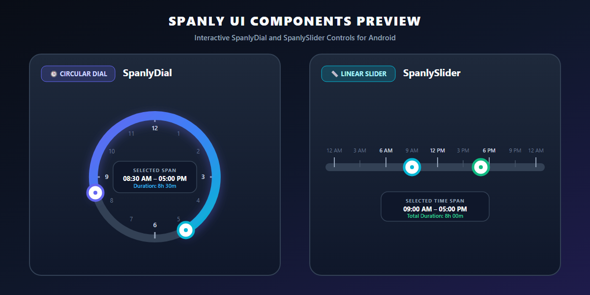

# Spanly

<p align="center">
  <a href="https://ervivekumrao.github.io/spanly">
    
  </a>
</p>

<p align="center">
  <a href="https://ervivekumrao.github.io/spanly">
    
  </a>
</p>

<p align="center">
  <a href="https://ervivekumrao.github.io/spanly"></a>
  <a href="https://central.sonatype.com/artifact/io.github.ervivekumrao/spanly"></a>
  <a href="LICENSE"></a>
  <a href="https://developer.android.com"></a>
</p>

---

## Overview

**Spanly** is a highly customizable, high-performance Time Span Selector library for Android. It provides both **Circular Dial** (`SpanlyDial`) and **Linear Slider** (`SpanlySlider`) controls for scheduling, alarm configuration, shift planning, and duration selection.

🌐 **Website & Documentation**: [https://ervivekumrao.github.io/spanly](https://ervivekumrao.github.io/spanly)

---

## UI Components Preview

<p align="center">
  <a href="https://ervivekumrao.github.io/spanly">
    
  </a>
</p>

---

## Key Features

- 🕒 **Dual Controls**: Choose between `SpanlyDial` (Circular Dial) and `SpanlySlider` (Linear Slider).
- 🌓 **Overnight Spans**: Built-in support for time spans crossing midnight (e.g. 10:00 PM – 6:00 AM).
- 🎨 **Theme Aware**: Automatic adaptation to Light and Dark Material Design themes.
- 📏 **Snap Intervals**: Snap handle dragging to 1, 5, 15, or 30-minute steps.
- 🕰️ **24h & 12h Modes**: Support for 24-hour and 12-hour AM/PM time formats.
- 📱 **Customizable**: Control track colors, thumb drawables, touch targets, tick marks, and text formatting.

---

## Installation

Add `mavenCentral()` to your `settings.gradle.kts`:

```kotlin
dependencyResolutionManagement {
    repositoriesMode.set(RepositoriesMode.FAIL_ON_PROJECT_REPOS)
    repositories {
        mavenCentral()
    }
}
```

Add the dependency to your app's `build.gradle.kts`:

```kotlin
dependencies {
    implementation("io.github.ervivekumrao:spanly:1.0.0")
}
```

---

## Usage

### 1. SpanlyDial (Circular Time Span Selector)

```xml
<umrao.spanly.SpanlyDial
    android:id="@+id/spanlyDial"
    android:layout_width="300dp"
    android:layout_height="300dp"
    app:tss_spanColor="#6366F1"
    app:tss_trackColor="#E2E8F0"
    app:tss_is24HourFormat="false"
    app:tss_spanTextPosition="center" />
```

### 2. SpanlySlider (Linear Time Span Selector)

```xml
<umrao.spanly.SpanlySlider
    android:id="@+id/spanlySlider"
    android:layout_width="match_parent"
    android:layout_height="wrap_content"
    app:tss_spanColor="#06B6D4"
    app:tss_spanTextPosition="bottom" />
```

### 3. Programmatic & Event Handling

```java
// Set selection programmatically (in minutes or formatted strings)
spanlyDial.setSpanInMinutes(480, 1020); // 08:00 AM to 05:00 PM
spanlyDial.setSpanTime("08:30", "18:45");

// Listen for span changes
spanlyDial.setOnSpanChangeListener(new ISpanly.OnSpanChangeListener() {
    @Override
    public void onSpanChanged(int startMinutes, int endMinutes, boolean isOvernight) {
        // Updated in real-time as user drags handles
    }

    @Override
    public void onInteractionFinished(int startMinutes, int endMinutes, boolean isOvernight) {
        // Touch interaction released
    }
});
```

---

## Configuration & Attributes

| Property | XML Attribute | Getter / Setter | Default | Description |
| :--- | :--- | :--- | :--- | :--- |
| **Start Time** | `tss_spanStartInMinutes` | `getSpanStartInMinutes()` / `setSpanStartInMinutes(int)` | `540` (09:00) | Start time in minutes from midnight (0–1439). |
| **End Time** | `tss_spanEndInMinutes` | `getSpanEndInMinutes()` / `setSpanEndInMinutes(int)` | `1020` (17:00) | End time in minutes from midnight (0–1439). |
| **Step Interval** | `tss_thumbMinuteStep` | `getThumbMinuteStep()` / `setThumbMinuteStep(int)` | `15` | Snap interval in minutes (1, 5, 15, 30). |
| **Overnight** | `tss_allowOvernightSpan` | `isOvernightSpanAllowed()` / `setOvernightSpanAllowed(bool)` | `true` (Dial), `false` (Slider) | Allow span to cross midnight. |
| **24-Hour** | `tss_is24HourFormat` | `is24HourFormat()` / `set24HourFormat(boolean)` | `true` | Toggle 24-hour vs 12-hour mode. |
| **Track Color** | `tss_trackColor` | `getTrackColor()` / `setTrackColor(int)` | `?attr/textColorSecondary` | Background track color. |
| **Span Color** | `tss_spanColor` | `getSpanColor()` / `setSpanColor(int)` | `?attr/colorPrimary` | Active selected span color. |
| **Thumb Radius** | `tss_thumbRadius` | `getThumbRadius()` / `setThumbRadius(float)` | `15dp` | Handle radius size. |
| **Start Icon** | `tss_startThumbDrawable` | `getStartThumbDrawable()` / `setStartThumbDrawable(Drawable)` | `null` | Custom start handle icon. |
| **End Icon** | `tss_endThumbDrawable` | `getEndThumbDrawable()` / `setEndThumbDrawable(Drawable)` | `null` | Custom end handle icon. |

---

## Documentation & Project Webpage

For full documentation, guides, and live interactive samples, visit:  
🔗 **[https://ervivekumrao.github.io/spanly](https://ervivekumrao.github.io/spanly)**

---

## License

Spanly is released under the **[Apache License 2.0](LICENSE)**.

---
---
